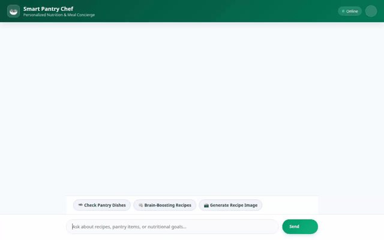

# 🥗 Smart Pantry Chef

Smart Pantry Chef is an AI-powered culinary assistant built with Google's Agent Development Kit (ADK), Vertex AI, Cloud Firestore, Cloud Storage, and Google Maps Platform. It helps users track pantry inventory, discover personalized low-glycemic recipes, calculate detailed nutritional metrics, locate nearby grocery stores, and generate high-quality food photography and video demonstrations.



---

## ✨ Features & Capabilities

Based on the codebase implementation in `app/`, Smart Pantry Chef provides the following capabilities:

- **📦 Pantry Inventory Management**: Search, add, update, and remove items in user pantry inventory stored in Cloud Firestore.
- **🍳 Recipe Search & Database Lookup**: Search Firestore recipes filtering by dietary preferences, preparation time, and glycemic load thresholds.
- **📊 Nutrition & Glycemic Load Calculation**: Automatically calculate total calories, protein, carbs, fats, and estimated glycemic load for any ingredient list.
- **📸 AI Food Image Generation**: Generate food photography using `gemini-3.1-flash-lite-image` (Vertex AI GenAI) with direct upload to Google Cloud Storage.
- **🎬 AI Culinary Video Generation**: Generate short food demonstration videos using Google's Omni model (`gemini-omni-flash-preview`) via the Vertex AI Interactions API.
- **🗺️ Grocery Location Services**: Geocode user addresses and locate nearby grocery stores, farmers markets, and specialty food markets using Google Maps Platform APIs.
- **🧠 User Preference Memory Persistence**: Long-term preference retention across sessions powered by `VertexAiMemoryBankService`.
- **🎨 Interactive Rich UI (A2UI)**: Dynamic component parsing and structured card rendering for supporting clients.

*Note: Features such as automated barcode scanning or IoT smart fridge sensor integration were discussed in early planning but are currently **planned, not yet implemented**.*

---

## 🛠️ Architecture & Google Cloud Integration

- **Agent Engine Framework**: Google Agent Development Kit (ADK) with `gemini-2.5-flash` model and sandbox python execution.
- **Memory Service**: Vertex AI Memory Bank (`VertexAiMemoryBankService`).
- **Database**: Google Cloud Firestore for persistent recipes and pantry state.
- **Media Storage**: Google Cloud Storage (GCS) bucket for public image and video artifact distribution.
- **Generative Media**: Vertex AI GenAI SDK (`gemini-3.1-flash-lite-image` and `gemini-omni-flash-preview`).
- **Location APIs**: `googlemaps` Python client for Geocoding and Places API queries.
- **Frontend Proxy**: FastAPI web interface serving a glassmorphic chat UI with dark/light mode switching and prompt chips.

---

## 🚀 Local Setup & Installation

### 1. Prerequisites

- Python 3.11+
- `uv` package manager installed (`pip install uv`)
- Google Cloud Project with Cloud Firestore, Vertex AI APIs, and Cloud Storage enabled.

### 2. Environment Configuration

Set the following environment variables in your shell:

```bash
export GCP_PROJECT_ID="your-gcp-project-id"
export GOOGLE_CLOUD_REGION="us-east1"
export GOOGLE_MAPS_API_KEY="your-google-maps-api-key"
export MEDIA_BUCKET_NAME="your-gcs-bucket-name"
```

### 3. Install Dependencies

Install required Python packages:

```bash
uv sync
```

### 4. Running the Application

#### Option A: Run Backend Agent Services

Run the ADK Agent locally using Python:

```bash
uv run python -m app.agent
```

#### Option B: Run Web Frontend Proxy Server

To start the local FastAPI web server:

```bash
cd frontend
AGENT_DIRECTORY="app" PORT=8080 uv run python main.py
```

After launching, navigate to `port 8080` in your web browser.

---

## 📁 Repository Structure

```text
├── app/
│   ├── agent.py            # ADK root agent configuration and tool registration
│   ├── firestore_tools.py  # Firestore pantry & recipe database tools
│   ├── image_tools.py      # Vertex AI Image & Video generation tools (GCS upload)
│   ├── maps_tools.py       # Google Maps Geocoding and Places tools
│   ├── a2ui_utils.py       # A2UI component rendering utilities
│   └── fast_api_app.py     # FastAPI application wrapper for ADK
├── frontend/
│   ├── main.py             # Proxy server routing user requests to Agent Engine
│   ├── Dockerfile          # Container specification for Cloud Run deployment
│   └── static/
│       └── index.html      # Responsive Web UI with dark mode & example prompts
├── agents-cli-manifest.yaml # Agent Engine deployment configuration
├── demo.gif                # Loop recording of the live agent in action
└── README.md               # Project documentation
```
